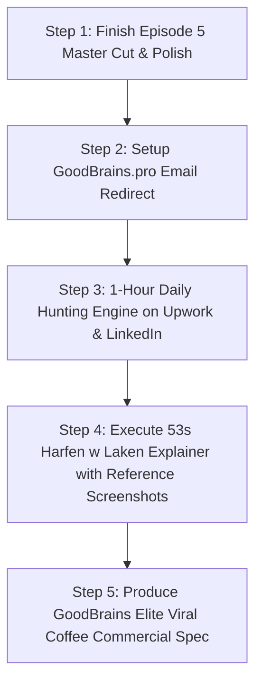

# 53-SECOND KINETIC EXPLAINER: PRODUCTION BLUEPRINT
## "Can AI Replace a Video Editor? | الأخبار ضد الواقع"

> **Status:** Architecture Locked 🔒  
> **Brand & Channel:** **Harfen w Laken (حرف ولكن)** exclusively.  
> **Target Audience:** Arabic Creative Community, Video Editors, Motion Designers & Tech Creators.  
> *(Note: GoodBrains is strictly reserved for high-end commercial specs, viral brand ads, and proven studio showcases).*

---

### 1. THE NARRATIVE & PSYCHOLOGICAL STRATEGY

#### The "News vs. Experience" Turnaround (Eliminating Hypocrisy)
- **The Problem:** Creators who only report doomy news cause "doom fatigue," leaving audiences anxious and swiping away. But ignoring the news makes creators look out of touch.
- **The Solution (The Turnaround):** Acknowledge the headlines first, then contrast them with real studio experience.
  - *"The headlines report the panic from the outside. But when you sit in the edit bay every day and build real projects, you discover what the news completely missed: AI can calculate a cut, but it cannot FEEL it."*
- **The Emotional Arc (53 Seconds):**
  1. `[0:00 - 0:04]` **The High-Stakes Hook:** Stops the scroll by addressing an industry existential fear.
  2. `[0:04 - 0:18]` **Technical Authority:** Name-dropping real tools (Opus Clip, CapCut, Premiere Pro, Kling) to prove deep technical mastery.
  3. `[0:18 - 0:34]` **The Emotional Pivot:** The heart of the video. Validates human taste, intuition, and emotional timing (*"when silence hits harder than music"*).
  4. `[0:34 - 0:46]` **The Mindset Shift & Agency:** Replaces paralysis with mission: *"You won't lose to AI; you'll lose to editors who use AI with human taste."*
  5. `[0:46 - 0:53]` **Authoritative Harfen w Laken Branded Sign-Off.**

---

### 2. SCRIPT OPTIONS PRESERVED FOR REVIEW

#### OPTION A: The Continuous Narrative Flow (Original Draft)
| Timing | Voiceover (السيناريو) | On-Screen Visuals |
|---|---|---|
| **0:00 – 0:04** | كل يوم الصبح، المانشيتات بتقول نفس الكلام: الذكاء الاصطناعي هيمسح المبدعين.. ونهاية عصر المحررين. | Red alert ticker flashes: `[ HEADLINES: CREATIVE COLLAPSE ]` on deep charcoal background. |
| **0:04 – 0:10** | الخوف مالي السوشيال ميديا.. بس لما تقعد قدام التايم لاين وتفتح البرامج دي بنفسك، بتكتشف الحقيقة اللي الأخبار مش فاهماها. | Fast motion sweep: Red alert shatters into cool deep cyan. Floating cards slide in. |
| **0:10 – 0:22** | أدوات زي **Opus Clip** بتقص الطويل لقصير في ثواني، **CapCut** بيفرغ الصوت فوراً، و**Kling** بيصنع مشاهد من سطر نص. | Glassmorphic cards for each tool with kinetic spring entries and glowing neon badges. |
| **0:22 – 0:34** | سرعة مجنونة؟ أه.. بس الذكاء الاصطناعي يقدر يقطع مشهد، لكن مستحيل يحسه. ميعرفش امتى يسيب الكادر يتنفس.. أو امتى الصمت بيبقى أقوى من أعلى مزيكا. | Motion slows down. Audio visualizer flattens into smooth silence. |
| **0:34 – 0:46** | اللي هيخسر الشغلانة مش اللي هينافس الذكاء الاصطناعي.. اللي هيخسر هو اللي مش عارف يستخدمه بذوقه البشري. متخافش من الأخبار.. اتعلم الأداة وافرض ذوقك. | High-contrast warm amber typography. |
| **0:46 – 0:53** | أنا ماريا.. وهنا حرفين و لكن. | Harfen w Laken signature signal outro. |

---

#### OPTION B: The Modular Card-by-Card Rhythm (harfen-video Architecture)
| Timing (Seconds) | Voiceover Track (ماريا) | On-Screen 3D & Kinetic Visuals |
|---|---|---|
| **0:00 – 0:03.4** | كل يوم الصبح، المانشيتات بتقول نفس الكلام: الذكاء الاصطناعي هيمسح المبدعين.. ونهاية عصر المحررين! هل ده حقيقي؟ لنكتشف. | **3D AI Core:** Rotating cyan wireframe icosahedron with pulsing inner gold core. Blurred kinetic typography snaps into focus. |
| **0:03.4 – 0:07.0** | **أوبس كليب (Opus Clip)..** بيحوّل الفيديو الطويل لمقاطع ريلز قصيرة في ثواني. | **Card 01/04:** 3D orbital node lights up yellow. Bold glowing text + animated gradient underline. |
| **0:07.2 – 0:10.8** | **كاب كات (CapCut)..** ترجمة وتفريغ صوتي فوري لكل كلمة بتتقال على الشاشة. | **Card 02/04:** Second 3D node illuminates yellow. Sleek subtitle HUD animation. |
| **0:11.0 – 0:14.6** | **بريمير برو (Premiere Pro)..** تعبئة توليدية بالذكاء الاصطناعي بتكمل وتملا الكادر بضغطة زر. | **Card 03/04:** Third 3D node pulses. Generative fill visual expansion. |
| **0:14.8 – 0:18.0** | **كلينج (Kling)..** بيصنع مشاهد وفيديوهات سينمائية كاملة من مجرد سطر نص مكتوب! | **Card 04/04:** Fourth 3D node flares. High-speed cinematic render sweep. |
| **0:18.0 – 0:35.0** | سرعة مجنونة؟ أه.. بس الذكاء الاصطناعي يقدر يقطع مشهد، لكن مستحيل يحسه. ميعرفش امتى يسيب الكادر يتنفس.. <br/>*(سكوت تام 3.5 ثانية - الويف فورم ينزل للصفر تماماً)*<br/> ..حين يكون الصمت أقوى من أعلى مزيكا. | **3D Audio Waveform:** 61 procedural equalizer bars dancing with Mariya's voice, then physically collapsing into dead flat silence at 31s–34.5s. Glowing typography: *"يقطع.. لكن لا يشعر."* |
| **0:35.0 – 0:45.0** | المحررين اللي هيخسروا.. مش هيخسروا قدام الذكاء الاصطناعي، بل قدام محررين بيعرفوا يستخدموه! متخافش من الأخبار.. اتعلم الأداة وافرض ذوقك البشري. | **3D Collision & Merge:** Blue "AI" and Yellow "Editor" wireframes drift across screen and collide into a single glowing burst. Warm amber text. |
| **0:45.0 – 0:53.0** | **أنا ماريا.. وهنا حرفين و لكن.** | **Anamorphic Lens Flare + Whip-Pan** transitioning straight into **Signature Signal Outro** (`heart-teal` & `heart-pink` spring-slamming together on circuit background). |


---

### 3. REMOTION MOTION GRAPHICS & ANIMATION ENGINE

#### A. Spring Physics Equations
Nothing moves linearly. Every element uses spring dynamics with gentle damping:
```tsx
import { spring, useCurrentFrame, useVideoConfig } from "remotion";

const frame = useCurrentFrame();
const { fps } = useVideoConfig();

// Natural organic bounce for cards and typography
const cardScale = spring({
  frame,
  fps,
  config: { damping: 14, stiffness: 120, mass: 0.8 },
});
```

#### B. Kinetic Typography Hierarchy
- **Word Limit:** 3 to 7 words per on-screen cluster (strictly optimized for mobile 9:16).
- **Mask-Wipe Reveals:** Text slides up from an invisible clipping mask (`overflow: hidden`) on the spoken beat.
- **Active Word Illumination:** The phrase is visible in muted slate gray (`#64748B`), and illuminates into crisp white (`#FFFFFF`) or electric cyan (`#00F2FE`) exactly as the spoken word hits.
- **Phrase Hold:** Every statement holds on screen for **0.3s to 0.5s** after the audio finishes to ensure 100% legibility before transitioning.

#### C. Floating 2.5D Glassmorphic Cards
- **Card Background:** `rgba(15, 23, 42, 0.75)` with `backdrop-filter: blur(16px)`.
- **Card Border:** 1px stroke with subtle rotating linear gradient shimmer.
- **Perspective Tilt:** `transform: perspective(1000px) rotateX(4deg) rotateY(-2deg)` that eases to flat on arrival.
- **Micro Camera Drift:** A continuous, silky push-in (`scale: 1.0 → 1.04` over the video duration) prevents any static feeling.

#### D. The Dynamic Audio & Background Canvas
- **Canvas Base:** Deep rich charcoal / midnight blue (`#0B0F17`).
- **Ambient Light Source:** A breathing radial gradient in the center that subtly pulses with the audio cadence.
- **Procedural Film Grain:** 2% SVG noise overlay to give the clean vector art a tactile, filmic texture.
- **Deliberate Silence:** At second 0:28 (on the line *"when silence hits harder than music"*), the background music ducks to absolute zero for 0.5s.

---

### 4. INCOMING ASSET INTEGRATION (THE SCREENSHOTS)

When you share your reference screenshots, we will extract:
1. **The Exact Card Geometry:** Border radius (e.g., 12px vs 20px), inner padding, and drop shadow depths.
2. **Icon & Badge Styling:** Whether the tool icons are flat 2D glyphs, isometric 3D badges, or neon wireframes.
3. **Typographic Weights:** The exact contrast ratio between headlines and sub-labels.

*(All tool SVGs for Opus, CapCut, Premiere, Kling, and DaVinci will be coded directly as native React components with glowing drop-shadow filters).*

---

### 5. STUDIO MASTER PRODUCTION SEQUENCE



1. **Episode 5 Master Cut:** Render and lock the 8-block high-retention documentary for Harfen w Laken.
2. **Email Safety:** Route `goodbrains.pro` Contact Form 43 leads to `sherif.seif@globevistahub.com`.
3. **Daily Hunting Ritual:** 60 focused minutes every morning pitching Upwork and LinkedIn using the Auto-Bath showcase and master commercial reels.
4. **The 53s Harfen w Laken Explainer:** Plug in the reference screenshots, record/generate Arabic VO, and build the Remotion composition.
5. **The GoodBrains Coffee Commercial:** Script, generate in NanoBanana Pro / Google Flow, and top with Remotion kinetic polish as GoodBrains’ flagship viral DTC spec!
