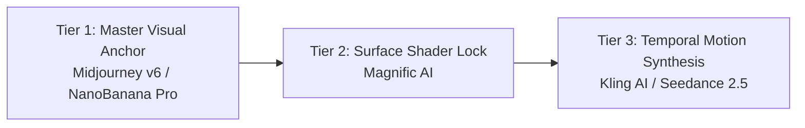

# THE 3D PIXAR CONSISTENCY & VIDEO AUTOMATION BLUEPRINT
## Transforming Daily Character Sheets into High-Retention 3D AI Videos Without Creator Burnout
**Document Version:** 1.0  
**Prepared by:** Good Brains | Creative Technology Studio  
**Target Architecture:** Pixar 3D Character Consistency & Automated Video Pipeline

---

## 1. EXECUTIVE DIAGNOSIS: THE "MANUAL CHATBOT SLOG"

Every day, you receive a character sheet from your client. Every day, you open a chat window, copy-paste descriptions, prompt Claude, manually tweak adjectives, export images, and paste them into video generation tools. 

You feel uninspired and drained because you are acting as a **manual human API router**.

### The 3 Hidden Points of Failure in the Current Workflow:

```
[Client Character Sheet]
           │
           ▼
[Manual Chatbot Prompting] ──► Flaw 1: PROMPT DRIFT (Claude rephrases descriptions slightly each day)
           │
           ▼
[Image Generator / Magnific] ──► Flaw 2: 3D SHADER DECAY (Eyes warp, skin turns photoreal/uncanny)
           │
           ▼
[Kling / Seedance Video Gen] ──► Flaw 3: MOTION MUTATION (Character anatomy melts during camera sweeps)
```

1. **Prompt Drift:** When you feed character descriptions into Claude manually in casual chat sessions, the semantic temperature fluctuates. A character described as *"a cute 3D Pixar-style boy with messy auburn hair"* on Monday becomes *"an animated young boy with reddish brown stylized hair"* on Tuesday. To AI video generators, those are two completely different human beings.
2. **The Pixar 3D Geometry Trap:** Pixar/Disney 3D animation relies on very specific shader physics: **subsurface scattering (SSS) on skin, clay/vinyl tactile textures, stylized exaggerated facial topology, and sharp spherical eye catchlights**. When prompted incorrectly, image and video models default to generic photorealism or grotesque plastic uncanny valley.
3. **Lack of Pipeline Decoupling:** You are forced to think about creative direction, prompt engineering, file management, and tool settings all at the same time.

---

## 2. THE OPTIMAL 3D PIXAR CREATIVE STACK

To eliminate character drift and achieve studio-grade Pixar aesthetic, your tools must be layered in a strict 3-tier pipeline:



### Tier 1: The Master Visual Anchor (Midjourney v6 / NanoBanana Pro)
- **Role:** Generates the master keyframe stills from the daily sheet.
- **The Pixar Style Formula:** Never use generic phrases like "cartoon". Use precise rendering tokens:
  `3D animation, Pixar render style, Octane Render, subsurface scattering, tactile vinyl skin texture, claymation soft lighting, volumetric rim light, expressive large eyes with specular highlights, stylized proportions, 8k resolution, cinematic color palette`
- **Character Reference Lock:** Use Midjourney's `--cref [URL]` with `--cw 100` (Character Weight) to lock facial features and wardrobe from the master reference sheet.

### Tier 2: The Shader & Detail Lock (Magnific AI)
- **Role:** Upscales and hardens the 3D Pixar textures before sending to video.
- **Critical Settings for Pixar 3D:**
  - **Preset:** 3D Animation / Stylized.
  - **Hallucination / Creativity:** Lock strictly between **0.1 and 0.2** (Never higher!). High hallucination adds real-world human pores and wrinkles, destroying the Pixar stylized skin.
  - **Resemblance:** Set to **0.8 – 0.9** to enforce 100% adherence to the master sheet.

### Tier 3: Temporal Motion Synthesis (Kling AI & Seedance 2.5 / Higgsfield)
- **Role:** Turning the upscaled keyframe into fluid cinematic motion.
- **Why Kling 4.0 & Seedance 2.5?**
  - **Kling 4.0 (The Game Changer):** Features **Omni Reference** (mix up to 10 character images + 5 videos) and **Multi-Keyframing (up to 10 keyframes)**. It natively renders **continuous takes up to 30 seconds** in 4K HDR. Eliminates facial morphing during head turns and complex camera arcs.
  - **Seedance 2.5:** Exceptional temporal consistency and clothing physics.
  - **Higgsfield:** Provides virtual camera rigs (pedestal up, slow orbit, cinematic push-in) that move the camera *around* the character without warping the body.

---

### 3. TECHNICAL ARCHITECTURE: WHY DIRECT API vs. MCP vs. n8n?

You asked whether to integrate Claude via **MCP (Model Context Protocol)**, **Pure Code (Direct API)**, or **n8n**. 

Here is the engineering trade-off comparison:

| Metric | Option A: Pure Code / Direct API *(Recommended)* | Option B: Claude via MCP | Option C: Pure n8n |
|---|---|---|---|
| **What it is** | A private, lightweight 1-page web app (Next.js / Python) connecting directly to Anthropic API. | A local server daemon running on your computer connecting Claude Desktop to your local disk. | A node-based visual workflow automation tool connecting webhooks. |
| **Where it runs** | In the cloud / browser (accessible from your laptop, Mac, or iPad anywhere). | Tied exclusively to your physical desktop computer and Claude Desktop app. | In a local or cloud n8n server container. |
| **User Experience** | **1-Click Simplicity:** Drop the character sheet $\rightarrow$ Click Generate $\rightarrow$ Copy formatted prompt queue. | **Chat-Bound:** Still requires chatting with Claude Desktop, maintaining local server configs. | **Flowchart:** Great for background triggers, but lacks a clean creative user interface. |
| **Setup Friction** | **Zero setup for you:** Hosted on a URL, ready to use immediately. | **High friction:** Requires Node.js runtime, JSON config edits, daemon restarts. | **Medium friction:** Requires managing n8n self-hosted instance or cloud subscription. |
| **Cost** | Pennies per daily sheet (Anthropic API raw token pricing: ~$0.02 per sheet). | Raw API tokens + local CPU usage. | Cloud subscription ($20+/mo) + API costs. |

#### Why NOT MCP for this specific workflow?
* **MCP is over-engineered for prompt compilation:** MCP was built for developers who need Claude to query SQL databases or execute local terminal scripts. 
* It does **not** solve your interface fatigue—you still have to sit inside a chat window.
* It does not run on your phone or tablet when you want to work remotely.

#### Why Pure Code (Direct API) is the Master Solution:
* You get a **private, branded Web Dashboard**:
  1. Box 1: Drop your client's daily character sheet (PDF or text).
  2. Box 2: Select desired scene actions (e.g., "Walking happily", "Shocked reaction", "Drinking coffee").
  3. **One Click:** The backend executes the locked Claude metaprompt via API and instantly returns a clean, structured table with exact Midjourney prompts, Kling motion parameters, and negative prompts ready to paste or auto-queue!

---

### 4. THE MASTER CLAUDE SYSTEM METAPROMPT (PLUG & PLAY)

Until your automated web interface is built, use this **locked System Prompt** inside Claude right now to immediately eliminate 80% of your daily mental fatigue:

```text
[SYSTEM INSTRUCTION: MASTER 3D PIXAR PROMPT COMPILER]

You are an expert Creative Technologist and AI Animation Director specializing in 3D Pixar/Disney-style character consistency for high-end video production (Midjourney v6, Magnific AI, Kling AI, Seedance 2.5, and Higgsfield).

Your task is to take raw daily client character sheets and convert them into an immutable, production-ready Prompt Matrix with ZERO character drift.

IMMUTABLE PIXAR VISUAL TOKENS (Always inject these into visual prompts):
"3D animation, Pixar render style, Octane Render, subsurface scattering on vinyl skin, stylized facial topology, large expressive eyes with sharp specular highlights, soft volumetric rim lighting, cinematic 8k, character design by Disney Pixar"

NEGATIVE PROMPTS TO ENFORCE:
"photorealistic, real human skin, wrinkles, pores, deformed hands, extra limbs, 2D flat illustration, sketch, blurry, plastic shine, uncanny valley"

OUTPUT FORMAT:
For every scene requested in the character sheet, output a clean markdown table with these exact columns:
1. Scene # & Shot Name
2. Camera & Lens (e.g., 50mm lens, eye-level medium close-up, slow push-in)
3. Midjourney v6 Anchor Prompt (Including --cref and Pixar visual tokens)
4. Magnific Upscale Guidance (Creativity locked at 0.15, 3D Stylized mode)
5. Kling AI / Seedance 2.5 Motion Prompt (Describing character physical actions, eye blinks, facial expressions, and camera motion physics)

When the user inputs a character sheet below, compile the matrix immediately without conversational filler.
```

---

### 5. THE AUTOMATION ROADMAP: MOVING TO 1-CLICK PRODUCTION

To permanently free yourself from the manual grind and scale your production capacity:

```
[Phase 1: SOP Adoption (Immediate)]
Use the locked Claude Metaprompt above to standardize daily outputs in under 10 minutes.

[Phase 2: The Turnkey Web Engine (Good Brains Custom Build)]
We engineer a private web dashboard for your studio:
• Client Sheet Ingestion (Drag-and-drop PDF/Docx).
• Direct Anthropic API orchestration with pre-tuned prompt compilers.
• 1-Click CSV/JSON export directly formatted for Kling and Higgsfield batch queues.
• Zero manual chatting. Output generated in under 5 seconds.
```

By decoupling yourself from manual prompt typing, you shift from being an exhausted prompt operator to an **Executive AI Animation Producer**.

---
*Good Brains | Creative Technology & Automated Production Pipelines*  
*Contact: contact@goodbrains.pro | Melbourne, Australia*
